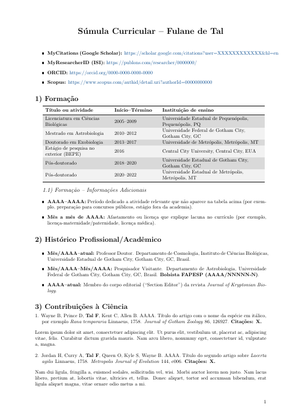
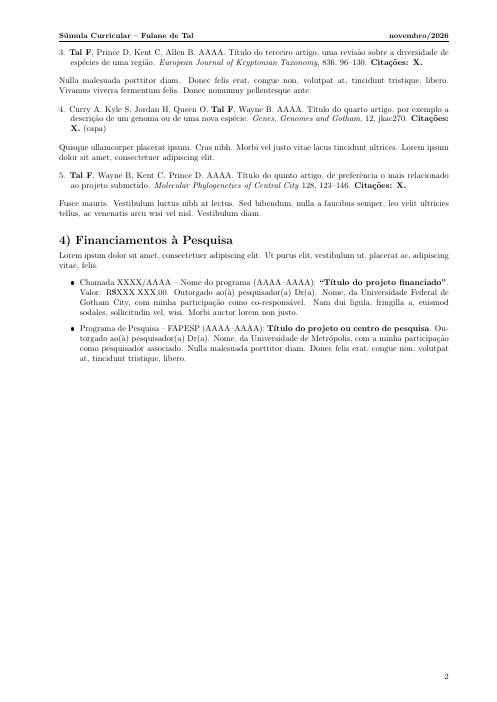
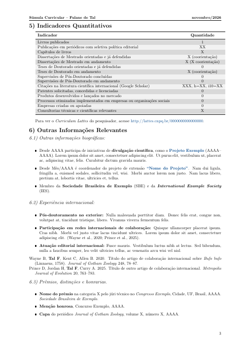

# Súmula Curricular FAPESP em LaTeX

Um modelo pronto para você montar a sua **Súmula Curricular** para propostas à FAPESP, sem precisar saber LaTeX.
Você troca os textos de exemplo pelos seus, clica em um botão e o PDF sai formatado.

> **Atenção:** todos os nomes, instituições, números e textos deste modelo são **fictícios** (Gotham City, Metrópolis e afins).
> Substitua tudo pelos seus dados antes de usar. Confira também o formato exigido na chamada em que você vai submeter, porque ele pode mudar (veja [Versão do formato](#versão-do-formato)).

Quer ver o resultado completo? Abra o [**exemplo.pdf**](exemplo.pdf).

|  Página 1  |  Página 2  |  Página 3  |
|:---:|:---:|:---:|
|  |  |  |

---

## Sumário

1. [O que você precisa](#1-o-que-você-precisa)
2. [Começando em 5 passos (pelo Overleaf)](#2-começando-em-5-passos-pelo-overleaf)
3. [O que é cada arquivo](#3-o-que-é-cada-arquivo)
4. [Como preencher cada seção](#4-como-preencher-cada-seção)
5. [Regras de escrita em LaTeX (leia antes de colar textos)](#5-regras-de-escrita-em-latex-leia-antes-de-colar-textos)
6. [As tabelas no Excel (formação e indicadores)](#6-as-tabelas-no-excel-formação-e-indicadores)
7. [Lista de conferência antes de enviar](#7-lista-de-conferência-antes-de-enviar)
8. [Outras formas de usar](#8-outras-formas-de-usar)
9. [Problemas comuns](#9-problemas-comuns)
10. [Privacidade](#10-privacidade)
11. [Versão do formato, licença e contribuições](#11-versão-do-formato-licença-e-contribuições)

---

## 1. O que você precisa

- Uma conta gratuita no [Overleaf](https://www.overleaf.com), um editor de LaTeX que funciona no navegador. Não é preciso instalar nada.
- O seu currículo (Lattes ou outro) à mão, para copiar os dados.
- **Excel** (ou outro programa de planilhas, como o LibreOffice, que é gratuito) no seu computador, para editar as duas tabelas do modelo.
- Seus identificadores de pesquisador, se tiver: Google Scholar, ORCID, Scopus, ResearcherID e Lattes. A seção [Como preencher](#4-como-preencher-cada-seção) mostra onde achar cada um.

Conhecimento prévio de LaTeX **não** é necessário. Você só vai editar textos dentro de arquivos prontos.

---

## 2. Começando em 5 passos (pelo Overleaf)

### Passo 1: Baixe o modelo
Nesta página do GitHub, clique no botão verde **Code** e depois em **Download ZIP**.
Guarde o arquivo em um lugar fácil de achar, como a pasta Downloads.

> Não descompacte o `.zip`: o Overleaf aceita o arquivo fechado.

### Passo 2: Envie para o Overleaf
1. Entre no Overleaf e clique em **New Project** (botão verde).
2. Escolha **Upload Project**.
3. Arraste o `.zip` para a janela, ou clique para escolher o arquivo.

### Passo 3: Confirme o arquivo principal
O projeto abre com os arquivos à esquerda e a pré-visualização à direita.
Clique em **Menu** (canto superior esquerdo) e confira:
- **Main document:** `main.tex`
- **Compiler:** `pdfLaTeX`

### Passo 4: Compile
Clique no botão verde **Recompile**. Em alguns segundos o PDF aparece à direita, igual às imagens do início desta página.

### Passo 5: Troque os exemplos pelos seus dados
1. Abra o `main.tex` e edite o bloco **DADOS DO PESQUISADOR**, nas primeiras linhas (veja [a seção 4](#4-como-preencher-cada-seção)).
2. Abra cada arquivo `1_formacao.tex`, `2_historico.tex` etc., e substitua os exemplos.
3. As **tabelas** de formação e de indicadores ficam em arquivos `.csv`, que o Overleaf não abre para edição. Você as edita no **Excel** no seu computador e sobe de volta. É simples, e o passo a passo está na [seção 6](#6-as-tabelas-no-excel-formação-e-indicadores).
4. Clique em **Recompile** sempre que quiser ver o resultado.

Para baixar o PDF final, clique no ícone de download (seta para baixo) acima da pré-visualização.

---

## 3. O que é cada arquivo

```text
.
├── main.tex                    ← documento principal (seus dados ficam no topo)
├── 1_formacao.tex              ← seção 1: Formação
├── formacao.csv                ← tabela de cursos (abra e edite no Excel)
├── 2_historico.tex             ← seção 2: Histórico profissional/acadêmico
├── 3_resultados.tex            ← seção 3: Contribuições à ciência
├── 4_financiamentos.tex        ← seção 4: Financiamentos à pesquisa
├── 5_indicadores.tex           ← seção 5: Indicadores quantitativos
├── indicadores.csv             ← tabela de indicadores (abra e edite no Excel)
├── 6_outras_informacoes.tex    ← seção 6: Outras informações relevantes
├── docs/                       ← imagens de prévia deste README (pode ignorar)
├── .github/workflows/          ← compilação automática no GitHub (pode ignorar)
├── LICENSE                     ← licença de uso (MIT)
└── README.md                   ← este guia
```

- **Linhas que começam com `%`** são **comentários**. O LaTeX as ignora. Aqui elas guardam as instruções oficiais da FAPESP para cada seção, então leia-as antes de preencher e não precisa apagá-las.
- **Seção sem arquivo:** se você apagar um arquivo de seção, ela aparece no PDF como *"Nada a declarar"*.

---

## 4. Como preencher cada seção

### Cabeçalho e identificadores (`main.tex`)

No topo do `main.tex` há este bloco. É o **único lugar** onde você escreve seu nome e IDs. O cabeçalho das páginas e os links usam esses valores automaticamente.

```latex
\newcommand{\PesquisadorNome}{Fulane de Tal}
\newcommand{\idScholar}{XXXXXXXXXXXX}
\newcommand{\idResearcher}{0000000}
\newcommand{\idORCID}{0000-0000-0000-0000}
\newcommand{\idScopus}{00000000000}
\newcommand{\idLattes}{0000000000000000}
```

Troque o que está **dentro das chaves da direita**. Não mexa no resto da linha.

| Identificador | Onde encontrar |
|---|---|
| `\idScholar` | Abra seu perfil no Google Scholar. No endereço, copie o que vem depois de `user=` e antes de `&`. |
| `\idResearcher` | O número no endereço do seu perfil no Publons/Web of Science (`.../researcher/NÚMERO/`). |
| `\idORCID` | Seu ORCID, no formato `0000-0000-0000-0000`. |
| `\idScopus` | O número do *Author ID* no Scopus. |
| `\idLattes` | Os 16 dígitos no final do endereço do seu Lattes (`lattes.cnpq.br/NÚMERO`). |

Se você não tem algum identificador, apague o `\item` correspondente na lista logo abaixo, dentro do `\begin{document}`.

### Seção 1: Formação (`1_formacao.tex`)
Tem duas partes: a **tabela de cursos**, que vem do `formacao.csv` e você edita no Excel (veja [a seção 6](#6-as-tabelas-no-excel-formação-e-indicadores)), e a lista **1.1 Informações Adicionais** neste `.tex`, para períodos fora da academia, licenças e afastamentos que expliquem lacunas.

### Seção 2: Histórico profissional/acadêmico (`2_historico.tex`)
Liste até **3** posições principais, com mês/ano de início e término e a instituição. Cada posição é uma linha que começa com `\item`. Para pôr algo em negrito, use `\textbf{texto}`.

```latex
\item \textbf{Mar/2022--atual:} Professor Doutor. Departamento, Instituto, Universidade, Cidade, UF, Brasil.
```

### Seção 3: Contribuições à ciência (`3_resultados.tex`)
Até **5** produtos principais. Para cada um existem duas partes:
1. **A referência** (dentro de `\cvpub{...}`), com **todos os autores até o máximo de 15**. Seu nome vai em negrito, usando `\textbf{Sobrenome I}`.
2. **A justificativa** (o parágrafo logo abaixo, que começa com `\noindent`), com **no máximo 5 linhas**: o impacto e a relevância para o seu projeto.

Os parágrafos de exemplo usam `\lipsum[...]`, que é um texto de enchimento. **Apague a linha inteira** e escreva o seu.

### Seção 4: Financiamentos (`4_financiamentos.tex`)
Até **5** financiamentos vigentes ou concluídos, como pesquisador responsável ou principal. Cada um é um `\item`. Se não houver nenhum, escreva uma frase dizendo isso.

### Seção 5: Indicadores (`5_indicadores.tex`)
Os números ficam no **`indicadores.csv`**, que você edita no Excel (veja [a seção 6](#6-as-tabelas-no-excel-formação-e-indicadores)). O link do Lattes no fim da seção usa o `\idLattes` do `main.tex`.

### Seção 6: Outras informações (`6_outras_informacoes.tex`)
Três blocos: **6.1** informações biográficas relevantes, **6.2** experiência internacional após o doutorado e **6.3** prêmios e distinções. Se algum bloco não se aplica, apague o conteúdo e escreva "Nada a declarar".

### Quando terminar: apague o texto de enchimento
Depois de substituir todos os trechos `\lipsum[...]`, procure no `main.tex` a linha abaixo e apague-a (ela só serve ao texto de exemplo):

```latex
\usepackage{lipsum}
```

---

## 5. Regras de escrita em LaTeX (leia antes de colar textos)

Alguns caracteres têm função especial. Se você os colar sem cuidado, a compilação falha. Veja como escrever cada um:

| Para aparecer | Escreva | Exemplo |
|---|---|---|
| `%` | `\%` | `20\% dos casos` |
| `&` | `\&` | `Ciência \& Tecnologia` |
| `$` | `\$` | `R\$ 10.000,00` |
| `#` | `\#` | `\#1` |
| `_` | `\_` | `nome\_do\_arquivo` |
| `—` ou `–` (intervalo) | `--` | `2018--2022` |
| **negrito** | `\textbf{texto}` | `\textbf{Silva F}` |
| *itálico* | `\textit{texto}` | `\textit{Rana temporaria}` |
| link | `\href{endereço}{texto}` | `\href{https://exemplo.org}{site}` |

Outras dicas:
- **Nomes científicos** vão em itálico: `\textit{Gênero espécie}`.
- **Aspas:** use `` ``texto'' `` (duas crases para abrir e duas aspas simples para fechar).
- **Parágrafo novo:** deixe uma linha em branco.
- **Acentos e cedilha:** pode digitar normalmente.

---

## 6. As tabelas no Excel (formação e indicadores)

Duas tabelas do modelo ficam em arquivos de planilha, para você editá-las **no Excel**, como qualquer planilha:

| Arquivo | Tabela |
|---|---|
| `formacao.csv` | Seção 1: cursos e estágios |
| `indicadores.csv` | Seção 5: indicadores quantitativos |

> O Overleaf não abre arquivos `.csv` para edição (aparece *"Sorry, no preview is available"*). Por isso o caminho é: **baixar, editar no Excel e subir de volta**.

### Passo a passo

**1. Baixe o arquivo do Overleaf.**
Clique no arquivo (por exemplo, `formacao.csv`) na lista à esquerda. Na tela que aparece, use o botão **Download**.
Se não encontrar o botão, vá em **Menu → Download → Source**, que baixa o projeto inteiro em `.zip`, e pegue o `.csv` de dentro dele.

**2. Abra no Excel.**
Dê duplo clique no arquivo baixado. As colunas devem aparecer separadas e com acentos corretos.

**3. Edite como uma planilha.**
- **Não altere a primeira linha** (os títulos das colunas).
- Cada linha seguinte é uma linha da tabela no PDF.
- Para **acrescentar** uma linha, escreva na primeira linha vazia, logo abaixo da última. Para **remover**, apague a linha inteira (clique no número da linha → botão direito → *Excluir*).
- Não deixe linhas vazias no meio da tabela.

**4. Salve no formato certo.** É o passo mais importante.
*Arquivo → Salvar como* e, em **Tipo**, escolha:

> **CSV UTF-8 (delimitado por vírgulas) (\*.csv)**

Mantenha o **mesmo nome** do arquivo (`formacao.csv` ou `indicadores.csv`). Se o Excel avisar que o formato "pode perder recursos", clique em **Sim** (ou *Manter formato*).

**5. Suba de volta no Overleaf.**
Arraste o arquivo para a lista de arquivos do projeto, ou clique no ícone de **Upload**. Quando perguntar, confirme que quer **substituir** o arquivo antigo.

**6. Compile.**
Clique em **Recompile** e confira a tabela no PDF.

### Cuidados importantes

- **Escolha o tipo "CSV UTF-8".** O tipo "CSV (separado por vírgulas)" comum salva os acentos errados (`Biologia` vira `Bi?logia` no PDF, ou o LaTeX dá erro).
- **Cuidado com datas.** O Excel transforma textos como `2018-2020` ou `03/2018` em datas e muda o que você escreveu. Escreva períodos com **dois hífens** (`2018--2020`) ou por extenso (`2018 a 2020`), como nos exemplos.
- **Evite `;` e aspas (`"`) dentro dos textos.** O ponto e vírgula é o separador de colunas. Se precisar, reescreva a frase.
- **Se tudo aparecer numa coluna só** ao abrir o arquivo: no Excel, vá em *Dados → Texto para Colunas → Delimitado → Ponto e vírgula*. Depois salve como no passo 4.
- **Se os acentos aparecerem quebrados** (`Pequenópolis`): em vez de dar duplo clique, abra o Excel e use *Dados → De Texto/CSV*, escolhendo a origem do arquivo **65001: Unicode (UTF-8)**.

### Outros programas

| Programa | Como fazer |
|---|---|
| **LibreOffice Calc** (gratuito) | Abra o arquivo e, em *Importar texto*, marque **UTF-8** e o separador **Ponto e vírgula**. Ao salvar, escolha *Texto CSV*, marque **Editar configurações de filtro** e use **UTF-8** e **Ponto e vírgula**. |
| **Excel no Mac** | O mesmo caminho. Em *Salvar como*, escolha **CSV UTF-8**. |
| **Google Planilhas** | **Não recomendado**: o CSV que ele exporta usa vírgula, e o modelo espera ponto e vírgula. Abra o arquivo no Excel ou no LibreOffice. |
| **Bloco de Notas ou outro editor de texto** | Funciona também, se você preferir. Cada linha é uma linha da tabela, com colunas separadas por `;`. |

---

## 7. Lista de conferência antes de enviar

- [ ] Troquei nome e IDs no bloco do `main.tex`.
- [ ] Editei `formacao.csv` e `indicadores.csv` no Excel e os salvei como **CSV UTF-8**.
- [ ] Substituí **todos** os textos de exemplo: procurei por `AAAA`, `XX`, `Exemplo`, `Gotham`, `Metrópolis`, `Fulane` e `lipsum` (no Overleaf, use `Ctrl+Shift+F` ou **Search** no menu).
- [ ] Respeitei os limites da FAPESP: até 3 posições em 2, até 5 itens em 3 e em 4, e até 5 linhas em cada justificativa.
- [ ] Todos os autores (até 15) constam em cada referência da seção 3.
- [ ] Os links e IDs abrem os perfis corretos.
- [ ] Removi `\usepackage{lipsum}`.
- [ ] Li o PDF de ponta a ponta no formato atual da chamada.
- [ ] Baixei o PDF final e guardei uma cópia do projeto.

---

## 8. Outras formas de usar

### Pelo GitHub, com PDF automático
Se você conhece o GitHub:
1. Clique em **Use this template → Create a new repository** (quando disponível) e escolha **Private**.
2. A cada alteração enviada, a **GitHub Action** compila o PDF sozinha.
3. Para baixar: aba **Actions** → execução mais recente → **Artifacts** → `sumula-pdf`.

### No seu computador
Instale uma distribuição LaTeX ([TeX Live](https://tug.org/texlive/) ou [MacTeX](https://tug.org/mactex/)) e rode, na pasta do projeto:

```bash
latexmk -pdf main.tex
```

O PDF aparece como `main.pdf`.

---

## 9. Problemas comuns

<details>
<summary><b>O PDF não aparece ou aparece "Compilation error"</b></summary>

Abra **Logs and output files** (ícone ao lado de Recompile) e procure a primeira linha que começa com `!`. Ela diz o tipo do erro e o número da linha. Quase sempre é um caractere especial sem a barra (veja [a seção 5](#5-regras-de-escrita-em-latex-leia-antes-de-colar-textos)), como `&`, `%` ou `_`.
</details>

<details>
<summary><b>A tabela de formação ou de indicadores está vazia, quebrada ou dá erro</b></summary>

Quase sempre é o jeito como o arquivo foi salvo. Confira, abrindo o `.csv` no Excel:
- Você salvou como **CSV UTF-8**? (veja o [passo 4 da seção 6](#6-as-tabelas-no-excel-formação-e-indicadores))
- A primeira linha (títulos) continua lá, e não há **linhas vazias** no meio?
- Todas as linhas têm o mesmo número de colunas?
- Algum texto tem `;` ou aspas?
- O nome do arquivo continua exatamente `formacao.csv` ou `indicadores.csv`?
</details>

<details>
<summary><b>Os acentos da tabela aparecem errados no PDF (ex.: "Bi?logia")</b></summary>

O arquivo foi salvo no tipo "CSV (separado por vírgulas)" comum. Abra o arquivo, use *Salvar como* e escolha **CSV UTF-8**, depois suba de novo no Overleaf.
</details>

<details>
<summary><b>O Excel mudou um período para uma data (ex.: "2018-2020" virou "jan/18")</b></summary>

Escreva períodos com dois hífens (`2018--2020`) ou por extenso (`2018 a 2020`). Se o Excel já converteu a célula, formate-a como **Texto** e digite de novo.
</details>

<details>
<summary><b>Aparecem "AAAA", "XX" ou texto em latim no PDF</b></summary>

São os exemplos que ainda não foram substituídos. Use a busca do projeto (`Ctrl+Shift+F`) para achá-los.
</details>

<details>
<summary><b>"File ... not found"</b></summary>

O LaTeX não achou um arquivo. Confira se o nome está igual ao do `main.tex` (maiúsculas, minúsculas e `_`) e se o arquivo está no projeto, na mesma pasta do `main.tex`.
</details>

<details>
<summary><b>"Nada a declarar" aparece em uma seção que eu preenchi</b></summary>

O arquivo da seção está com outro nome ou foi movido de pasta. Os nomes devem ser exatamente `1_formacao.tex`, `2_historico.tex`, `3_resultados.tex`, `4_financiamentos.tex`, `5_indicadores.tex` e `6_outras_informacoes.tex`.
</details>

<details>
<summary><b>O mês e o ano do cabeçalho mudaram sozinhos</b></summary>

É intencional: o cabeçalho mostra o mês e o ano da **última compilação**. Compile novamente no dia em que for gerar o PDF final.
</details>

<details>
<summary><b>Estou com um erro que não está aqui</b></summary>

Abra uma *issue* neste repositório, copiando a mensagem de erro do log e dizendo qual arquivo você estava editando.
</details>

---

## 10. Privacidade

A súmula traz dados pessoais e projetos em andamento.

- Ao usar o modelo com seu currículo real, mantenha o projeto **privado** (no Overleaf, não compartilhe o link com acesso aberto).
- Se for usar o GitHub, crie o seu repositório como **Private**. Se um repositório privado for tornado público, **todo o histórico de alterações** fica visível, inclusive o que você já apagou.
- Este repositório contém apenas dados fictícios.

---

## 11. Versão do formato, licença e contribuições

### Versão do formato
Modelo baseado nas seções da súmula curricular FAPESP vigentes em **novembro de 2026**. As regras mudam entre chamadas, então confirme na sua.

### Licença
[MIT](LICENSE). Você pode usar, adaptar e compartilhar livremente, inclusive este guia.

### Contribuições
Encontrou um erro, tem uma sugestão ou quer um exemplo de outra área? Abra uma *issue* ou envie um *pull request*. Dúvidas de iniciante também são bem-vindas.
